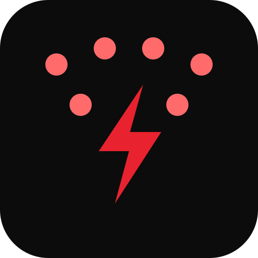

---

## About Me

Informatics graduate (GPA 3.76, cum laude) from Telkom University. I build web and mobile applications end to end, from database design to deployment. I delivered two paid client platforms as a freelancer (INDETA and SUGIH), shipped an internal system at PT Pos Indonesia, and presented a machine learning paper at [IC2IE 2026](https://ic2ie.org/) as first author.

---

## Featured Projects

<table><tr>
<td width="50%" valign="top">

### [Blister64](https://github.com/ariefusry/diecast-auction)
1:64 diecast auction site with a simulated escrow wallet, anti-sniping, and buy-now. Gemini turns plain-language searches into filters.

Go · PostgreSQL · React · Docker · AWS EC2 
<a href="https://blister64.ariefusry.me">Live ↗</a> · <a href="https://github.com/ariefusry/diecast-auction">Repo</a>
</td>
<td width="50%" valign="top">

### [Lajur](https://github.com/ariefusry/lajur)
AI-assisted job tracker for Indonesian job seekers. Kanban board, H-3/H-1 email reminders, AI form-fill with PII redaction.

Next.js · TypeScript · Prisma · Neon · Groq 
<a href="https://lajur.vercel.app">Live ↗</a> · <a href="https://github.com/ariefusry/lajur">Repo</a>
</td>
</tr><tr>
<td width="50%" valign="top">

### [Commission Tracker](https://github.com/ariefusry/Commission-Tracker)
Order management PWA for illustrators. Drag-and-drop Kanban, income dashboard, private tracking page per client.

Next.js · TypeScript · Supabase 
<a href="https://commission-tracker-one.vercel.app">Live ↗</a> · <a href="https://github.com/ariefusry/Commission-Tracker">Repo</a>
</td>
<td width="50%" valign="top">

### [Portfolio](https://github.com/ariefusry/Website-Portofolio)
Bilingual portfolio with a Supabase-backed admin dashboard and RLS. Falls back to seed content when the database is unreachable.

Next.js · TypeScript · Supabase 
<a href="https://ariefusry.me">Live ↗</a> · <a href="https://github.com/ariefusry/Website-Portofolio">Repo</a>
</td>
</tr><tr>
<td width="50%" valign="top">

### [INDETA](https://github.com/ariefusry/INDETA)
Tourism and UMKM platform with destination, product, travel package, article and review modules. Installable as PWA.

Laravel · Tailwind CSS · Supabase 
<a href="https://indeta.vercel.app">Live ↗</a> · <a href="https://github.com/ariefusry/INDETA">Repo</a>
</td>
<td width="50%" valign="top">

### [SUGIH](https://github.com/ghazyfadhal/sugih)
Company profile with animated public site and custom admin panel with drag-and-drop product ordering.

Laravel · Alpine.js · GSAP · PostgreSQL 
<a href="https://sugih.vercel.app">Live ↗</a> · <a href="https://github.com/ghazyfadhal/sugih">Repo</a>
</td>
</tr><tr>
<td colspan="2" valign="top">

### [haiku-swarm-strike](https://github.com/ariefusry/haiku-swarm-strike)
Claude Code skill. Up to 10 Haiku subagents explore read-only, then Opus checks their findings, decides, and is the only agent that makes changes.

Claude Code · Agent Skills · Subagents 
<code>npx skills add ariefusry/haiku-swarm-strike</code> · <a href="https://github.com/ariefusry/haiku-swarm-strike">Repo</a>
</td>
</tr></table>

---

## Research

**[Prediction of ER-LBD Toxicity using ANN Optimized by Grey Wolf Optimizer](https://github.com/ariefusry/Prediction-of-ER-LBD-Toxicity-using-ANN-Optimized-by-Grey-Wolf-Optimizer)** · [IC2IE 2026](https://ic2ie.org/), first author

A neural network tuned by the Grey Wolf Optimizer that predicts whether a chemical is toxic to the estrogen receptor, trained on heavily imbalanced data (18.6 non-toxic samples per toxic one).

---

## Activity

---

